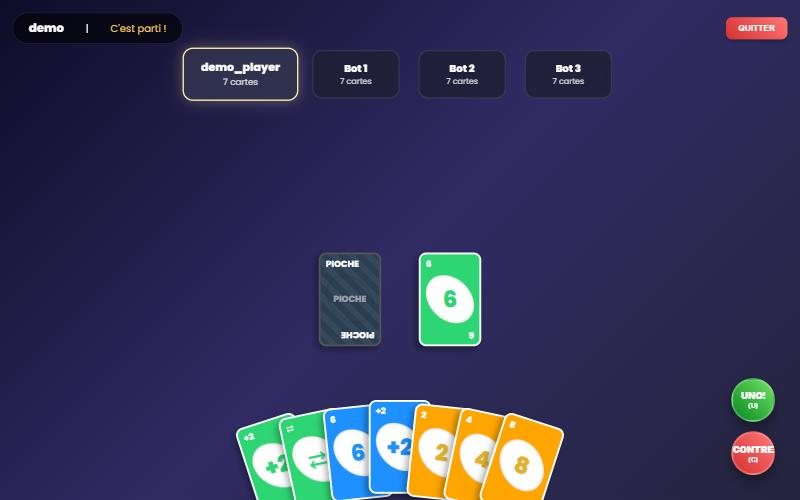

# UN'Online — real-time multiplayer UNO

A browser-based multiplayer UNO game: accounts, public and password-protected rooms, bots,
optional house rules, an ELO leaderboard and friends, all synchronised in real time over WebSockets.



> Team project for the software development course (TDLOG) at École des Ponts, 2025-2026,
> by Flavie Hy, Matteo Guibert and Erwann Cognet. The interface and the code identifiers are in French.

## Features

- **Real-time multiplayer** with Flask-SocketIO: each room is a Socket.IO room, the server is the single
  source of truth and broadcasts the public game state, while each player privately receives their own hand.
- **Rooms**: public rooms are listed in the lobby, private rooms are protected by a password,
  and people who join a running game become spectators.
- **Bots** to fill a table (simple heuristic: play the first legal card, choose the colour you hold most of).
- **House rules**, toggled per game: stacking +2 cards, stacking +4 on +2, and jump-in (playing an identical card out of turn).
- **Full UNO mechanics**: reverse, skip, wild cards, calling "UNO" and calling out a player who forgot,
  and challenging a +4 bluff.
- **Accounts** with hashed passwords (Werkzeug) and sessions (Flask-Login), an **ELO-like ranking**,
  a top-10 leaderboard, friends, and admin endpoints to moderate rooms and users.

## Architecture

```
app.py          Flask app: REST API (auth, rooms, leaderboard, friends, admin) + Socket.IO events
uno_logic.py    Game engine (MoteurUno): deck, turns, card effects, house rules, bot policy. No I/O.
models.py       SQLAlchemy models: User (stats, ELO, friends), GameHistory
static/         Single-page front-end (vanilla JS + Socket.IO client)
tests/          Unit and scenario tests for the game engine
scripts/        make_admin.py, simulate_game.py (bot-only game in the terminal),
                headless_client.py (3 scripted clients that play against a running server)
```

Keeping the game engine free of any network or database code is what makes it testable on its own:
the tests drive `MoteurUno` directly, and the server only translates Socket.IO events into engine calls.

## Run it locally

```bash
python -m venv .venv
source .venv/bin/activate          # Windows: .venv\Scripts\activate
pip install -r requirements.txt
python app.py                      # http://127.0.0.1:5000
```

Create an account, create a room, add a few bots and start the game.
Configuration comes from environment variables: `SECRET_KEY` (set it for anything other than local use),
`DATABASE_URL`, `HOST`, `PORT`, `CORS_ORIGINS` and `FLASK_DEBUG=1`.

To give a user admin rights: `python scripts/make_admin.py`.

## Tests

```bash
pip install -r requirements-dev.txt
pytest -q
```

They cover card compatibility, dealing, turn order, the +2 / +4 effects, stacking rules, +4 bluff challenges,
hand sorting and full mini-scenarios. They run on every push with GitHub Actions.

## Limitations

- Game state lives in memory, so restarting the server ends the games in progress and the app runs as a single process.
- The ELO update is a fixed +/- score, not a real Elo formula.
- The bots are deliberately naive.
